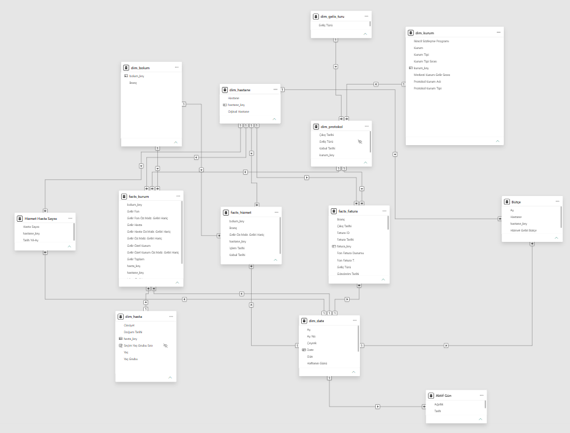
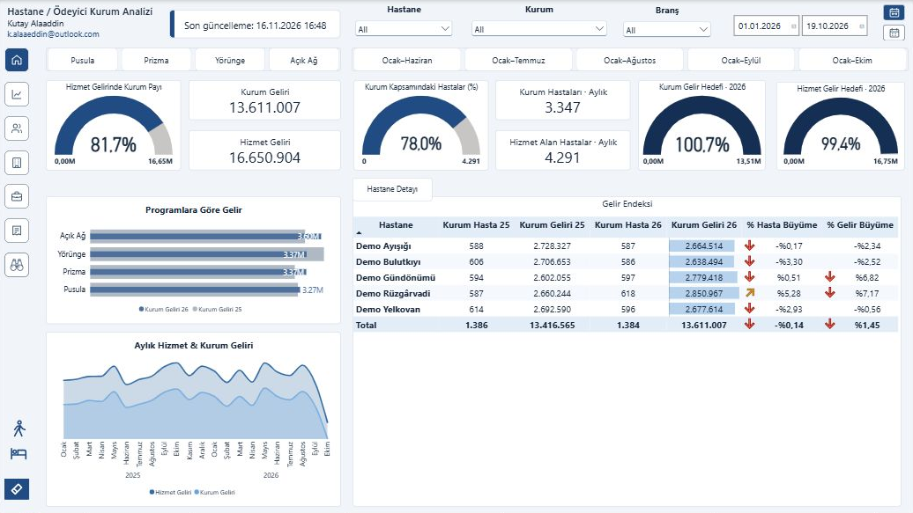
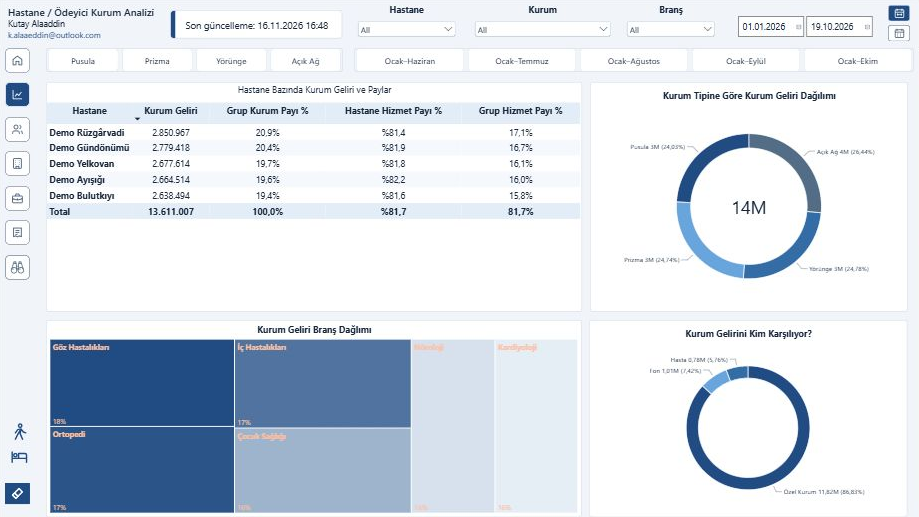
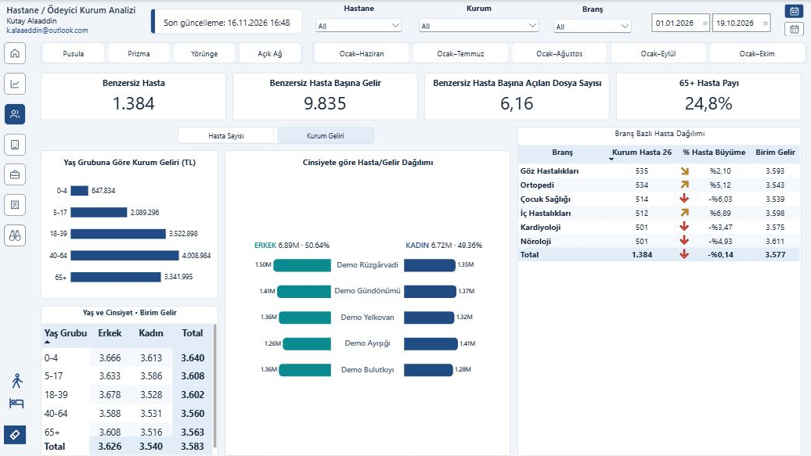
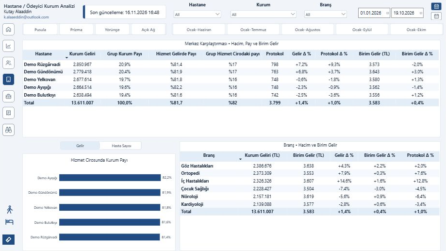
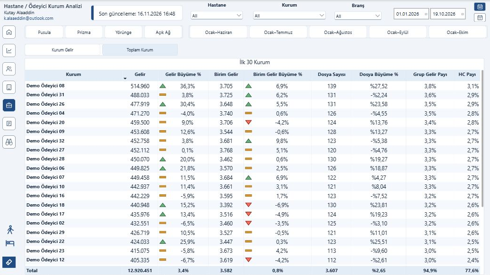
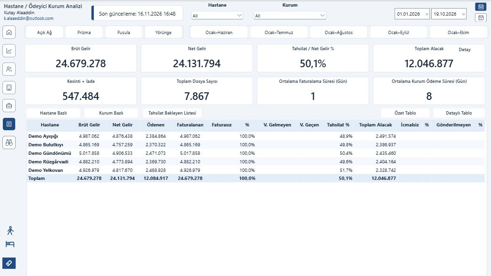
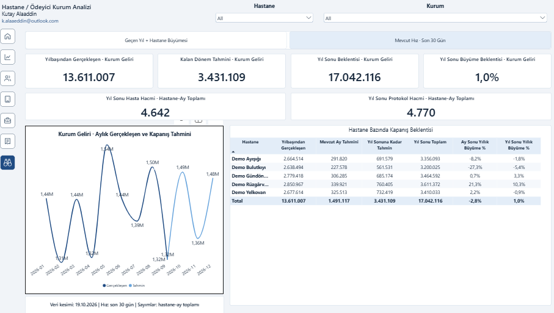

# Kurum Analitiği | Power BI Demo Proje

Hastane ve ödeyici kurumların gelir, bütçe ve tahsilat performansını incelemek için hazırlanmış bir Power BI projesidir. Rapor, kurum gelirinin hangi hastane ve branşlardan oluştuğunu, bütçe hedeflerine ne ölçüde ulaşıldığını ve faturalanan tutarın ne kadarının tahsil edildiğini gösterir.

**Tüm iş verileri Python ile örnek amaçlı üretilmiştir. Gerçek veriler paylaşılmamıştır.** Hastaneler, ödeyiciler, hasta ve protokol anahtarları, faturalar, bütçeler ve tahsilatlar kurgusaldır.

**[Canlı raporu Power BI’da aç](https://app.powerbi.com/view?r=eyJrIjoiN2U2NTRhNmQtYTFlYS00M2NiLTg0MWEtZTkwNzFlMWI1ZDU2IiwidCI6ImQ5NjQ2ZTQyLTUzMWQtNDBlNC1hMDQ3LTBkOGU3ZDFhNmNlNCIsImMiOjl9)**

**[Power BI Desktop dosyasını indir (.pbix)](./Hastane-Kurum-Analizi.pbix)**

## Veri modeli

Kurum geliri, hizmet geliri ve fatura hareketleri ayrı işlem tablolarında tutulur. Tarih, hastane, branş, hasta ve kurum boyutları üzerinden farklı analiz düzeylerine geçilebilir. Bütçe verisi hastane ve ay düzeyinde modellenmiştir.

Ödeyici kurum ile gelir ve fatura hareketleri arasındaki bağlantı protokol üzerinden kurulur. Ortak boyutlar, aynı hastane ve döneme ait sonuçların birlikte incelenmesini sağlar.

DAX ölçüleri gelir payı, bütçe gerçekleşmesi, tahsilat oranı, birim gelir ve dönemsel değişimleri hesaplar. Hasta ve protokol sayılarında tekil sayım kullanılır. Aylık hasta sayılarının toplamı ile dönem genelindeki tekil hasta sayısı ayrı değerlendirilir.

## Rapor görünümleri

### Portföye Genel Bakış

Kurum geliri, hasta sayısı, hizmet geliri içindeki kurum payı ve bütçe gerçekleşmesi aynı ekranda izlenebilir. Hastane, kurum, branş ve dönem filtreleriyle analiz daraltılabilir.

### Gelirin Kaynakları

Gelirin hastane, branş ve sözleşme programlarına dağılımını gösterir. Hastanelerin grup gelirindeki payı ile kendi hizmet gelirleri içindeki kurum payı birlikte incelenebilir.

### Başvuru Profili

Hasta sayısı ve gelir, yaş grubu ve cinsiyet kırılımlarında karşılaştırılabilir. Hasta başına gelir ve açılan dosya sayısı, başvuru hacminin yorumlanmasına yardımcı olur.

### Merkez Karşılaştırması

Hastaneler gelir, protokol sayısı, birim gelir ve önceki yıla göre değişim açısından karşılaştırılabilir. Gelirdeki değişime hacim veya birim gelir artışının nasıl eşlik ettiği görülebilir.

### Ödeyici Karşılaştırması

Ödeyici kurumların gelir sıralaması, dosya sayısı, birim geliri ve büyüme oranları birlikte sunulur.

### Alacak Takibi

Brüt gelir, kesinti ve iadeler, net gelir, tahsilat ve açık alacak birlikte izlenebilir. Hastane ve kurum görünümleri arasında geçiş yapılarak ödeme durumu incelenebilir.

### Projeksiyon

Son veri tarihine kadar gerçekleşen gelir ile kalan döneme ilişkin tahmin birlikte gösterilir. Yıl sonu beklentisi, son 30 günün hızına veya önceki yıl ve hastane büyümesine dayanan yaklaşımlarla incelenebilir.

## Raporu bilgisayarınızda açma

[Hastane-Kurum-Analizi.pbix](./Hastane-Kurum-Analizi.pbix) dosyasını indirin ve Power BI Desktop ile açın. Örnek veriler dosyaya gömülüdür. Raporu görüntülemek için veri yenilemeniz, Python kurmanız veya bir veri kaynağına bağlanmanız gerekmez.

## Örnek veri seti

Beş kurgusal hastane, 32 ödeyici kurum ve altı branş için 8.522 örnek protokol üretilmiştir. İşlem dönemi Ocak 2025–19 Ekim 2026 arasındadır. Takvim ve aylık bütçeler 2026 sonuna kadar uzanır.

Örnek senaryo tam ödeme, kısmi ödeme, açık alacak ve henüz faturası bulunmayan protokoller içerir. Pusula, Prizma, Yörünge ve Açık Ağ kurgusal sözleşme programlarıdır.

## Ölçüler ve gezinme

Proje 23 model tablosu, 18 ilişki ve 275 DAX ölçüsü içerir. Yer imleri, aynı sayfa içinde farklı analiz görünümlerine geçiş sağlar.

Ölçülerin 123 tanesi rapor tanımlarında doğrudan kullanılır. 59 ölçüye model ifadeleri, sorgular veya diğer ölçülerin bağımlılıkları üzerinden başvurulur. Kalan 93 ölçü, ilerideki analizlerde kullanılmak üzere **Rapor dışında kalanlar** klasöründe konularına göre gruplandırılmıştır.

